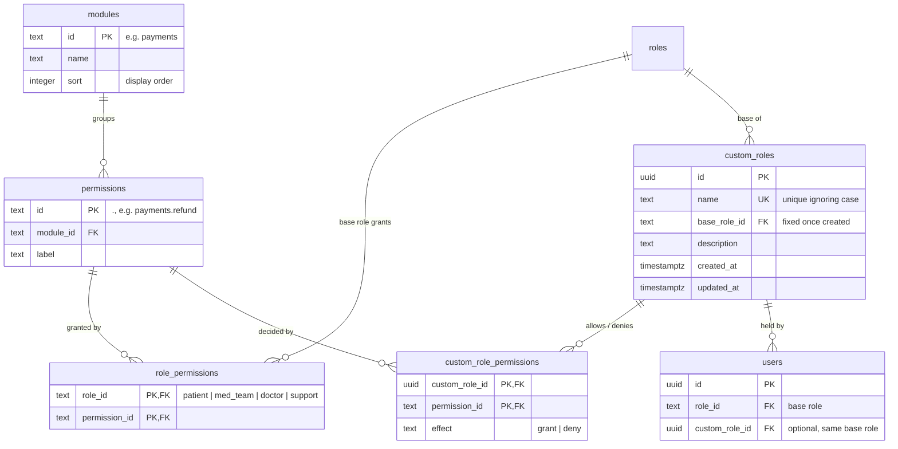
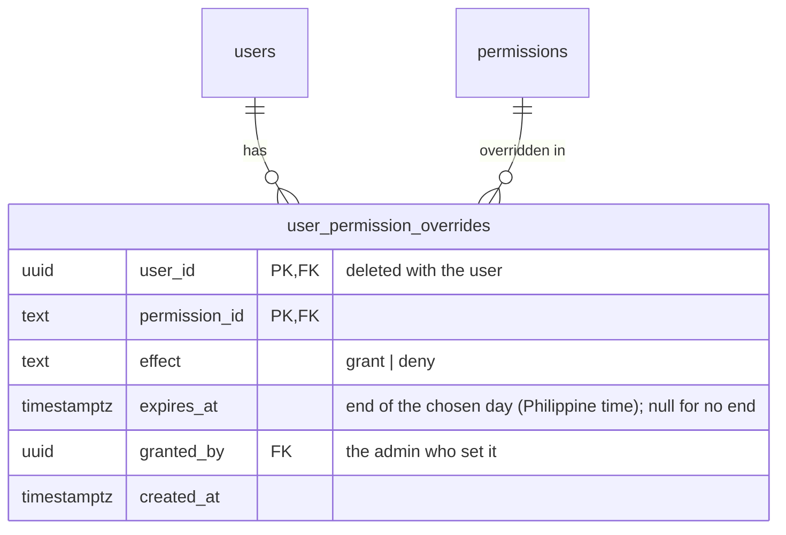

# ERD: Access (Roles & Permissions)

Tables added by Module 2. See [PERMISSIONS.md](../PERMISSIONS.md) for the rules.

**Notes**

- `modules`, `permissions` and `role_permissions` are written by `turbo run db:seed` from `packages/shared/src/permissions.ts`. Permissions removed from the catalogue are deleted, along with their grants.
- Admin has no `role_permissions` rows: it always has every permission.
- A custom role lists only the permissions it changes; everything else is inherited from its base role.
- A user's custom role must be built on the user's base role. A custom role can't be deleted while `users.custom_role_id` points at it (`ON DELETE RESTRICT`).
- The seed creates the _President_ and _Senior Med Tech_ roles once; admins' later edits to them are kept on re-seed.

## Per-user overrides

- Checked first: user override → custom role → base role → deny. An expired override is ignored.
- Saving replaces all of a person's overrides at once. Admins can't be overridden (they always have everything), and nobody overrides themselves.
