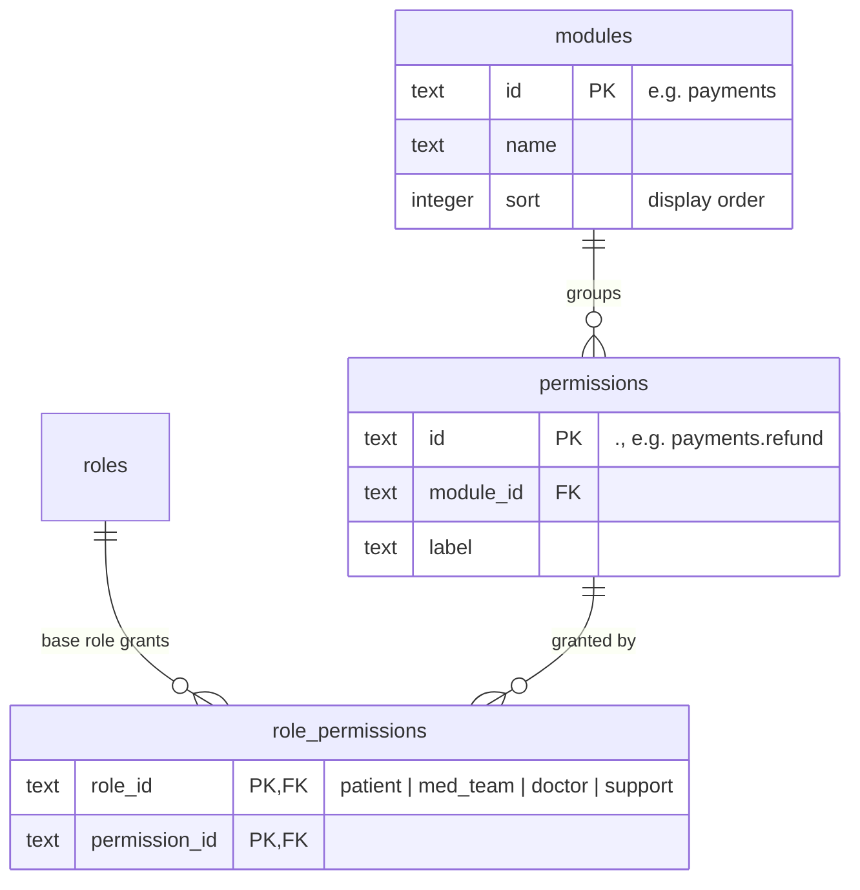

# ERD: Access (Roles & Permissions)

Tables added by Module 2. See [PERMISSIONS.md](../PERMISSIONS.md) for the rules.

**Notes**

- All three tables are written by `turbo run db:seed` from `packages/shared/src/permissions.ts`. Permissions removed from the catalogue are deleted, along with their grants.
- Admin has no `role_permissions` rows: it always has every permission.
