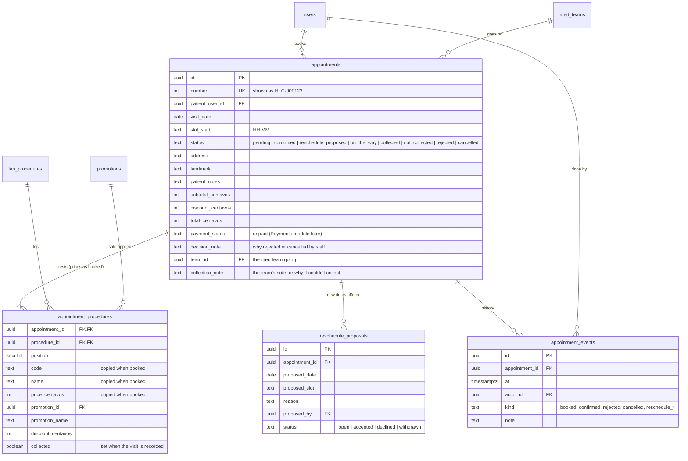

# ERD: Appointments

Tables added by Module 5 (slices 5A booking, 5B staff review, 5C team assignment and visits). Dates are whole days and times are "HH:MM", in Philippine time. Money is centavos.

**Rules**

- **Time slots** run from the visit start to the visit end in steps of the slot length (Settings), e.g. 06:00–12:00 in 60-minute slots gives 06:00 … 11:00.
- **A day can be booked** when it is a visit day, isn't a closed day, is within the booking window, and at least one slot starts after the minimum notice.
- **Capacity:** a med team is _on duty_ on a date when it is active, has a roster for that two-week period, and at least one member is working that day (approved leave counts as not working). Each team on duty takes **one visit per slot**, and at most **visits per team per day** (Settings) in the day. Pending, confirmed and reschedule_proposed bookings hold a place.
- **No double booking:** saving a booking locks its date (`pg_advisory_xact_lock`) and re-counts, so two patients can't both take the last place (the second gets 409 `slot_full`).
- **Prices are copied** onto `appointment_procedures` when booked, with the best running promotion; later price changes don't affect the booking.
- **Status flow:** a booking starts `pending` (or `confirmed` when Settings → booking approval is automatic). Staff accept (`confirmed`) or reject (`rejected`, with a reason). Staff can propose a new time (`reschedule_proposed`); the patient accepts (the visit moves there and is `confirmed`, if the slot still has room) or declines (`cancelled`). Patients cancel their own up to the cancellation cut-off; staff with `appointments.cancel` cancel any time with a reason.
- **Emails** go to the patient when a booking is received, confirmed, rejected, given a new time or cancelled by staff. A failed email never undoes the change.
- **Team assignment:** a confirmed visit goes to one med team on duty that day. A team does one visit per slot and at most _visits per team per day_. With Settings → team assignment **auto**, a visit is given to the free team with the fewest visits that day (ties A–Z) as soon as it's confirmed; if none is free, staff assign it. With **manual**, staff with `appointments.assign` pick the team. Moving a visit to a new time takes its team away (re-assigned automatically in auto mode). The check and the write happen under the date's lock, so two visits can't take the same team and slot.
- **The visit:** a member of the assigned team (`visits.collect`) marks it **on the way**, then **collected** (ticking which tests' samples were taken, with an optional note) or **not collected** (with the reason). Collected and not-collected visits still count toward the team's day.
- `turbo run db:seed` adds four sample bookings (patient01–03) on an empty database; the confirmed one goes to Team Makati.
