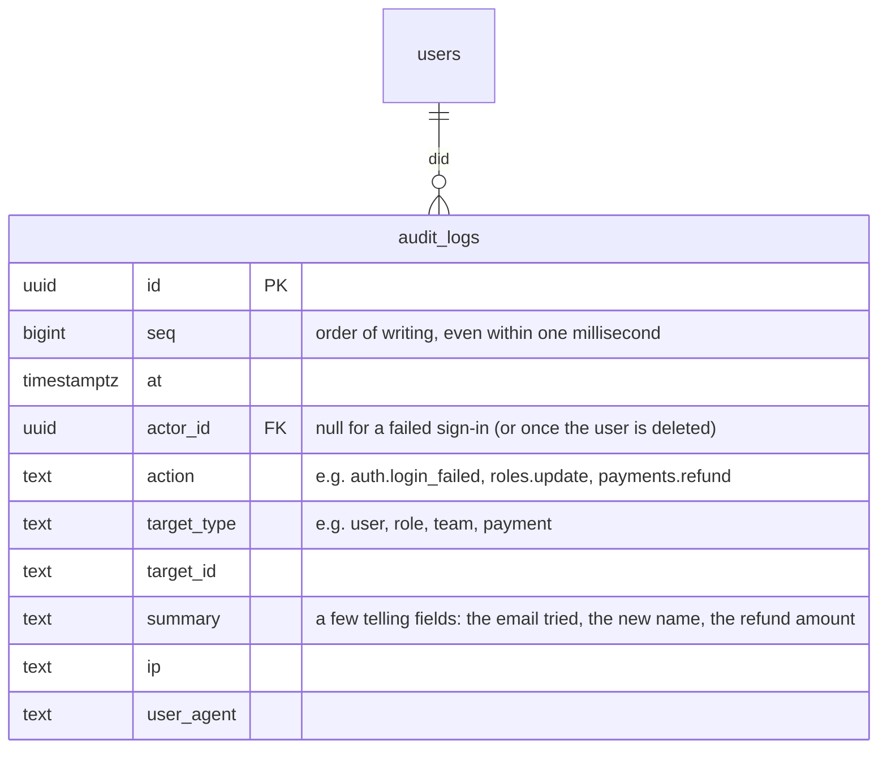

# ERD: Audit logs

Table added by Module 10. Rows are only ever added: nothing in the app edits or deletes them.

**What's recorded**

- **Sign-ins:** `auth.login`, `auth.login_failed` (the email tried; never the password), `auth.logout`, `auth.password_changed`.
- **Admin changes:** users (create, (de)activate, reissue password, assign role), roles (create, update, delete), settings, closed days, catalog (categories, tests, promotions), teams and rosters, shifts, leave decisions, refunds and cash payments.
- Only calls that succeed are recorded, except sign-ins, where failures are recorded too.
- Writing the log never fails the action: if it can't be written, the error is reported in the server log and the action still goes through.

**How:** an `AuditedController` wraps the controllers listed in `apps/api/src/interface/http/auditPlan.ts`; no use case knows about the log. Appointment history stays in `appointment_events`.
