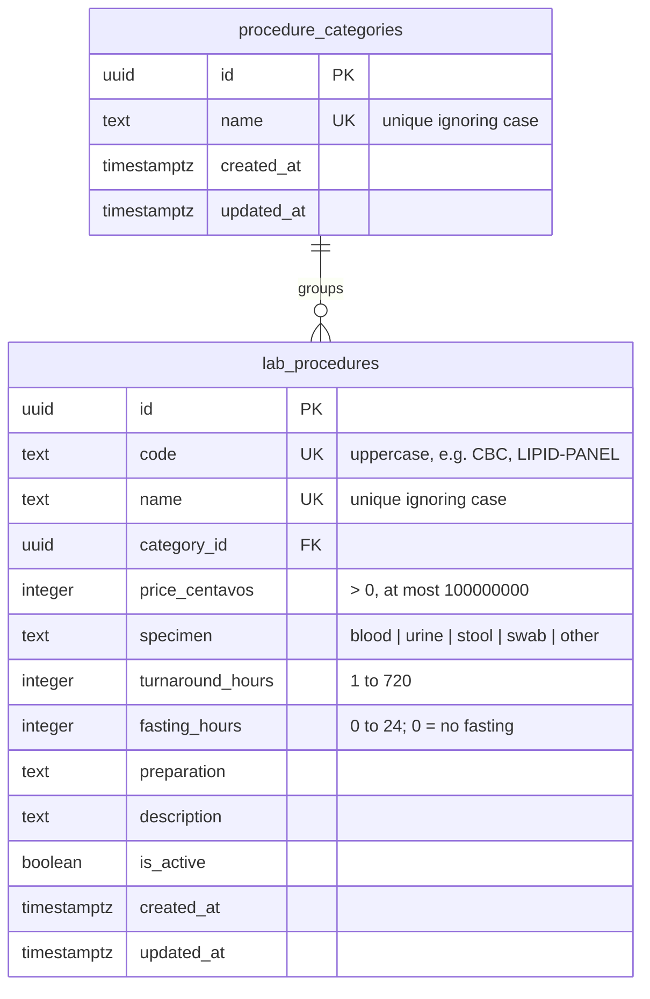

# ERD: Catalog (Lab Procedures)

Tables added by Module 3. Prices are integer centavos (`35000` = ₱350.00).

**Notes**

- Procedures are deactivated, never deleted, so appointments and payments keep pointing at them.
- A category can't be deleted while any procedure (active or not) is in it (`ON DELETE RESTRICT`).
- `turbo run db:seed` adds 6 categories and 21 procedures once, by code; admins' later price changes are kept on re-seed.
