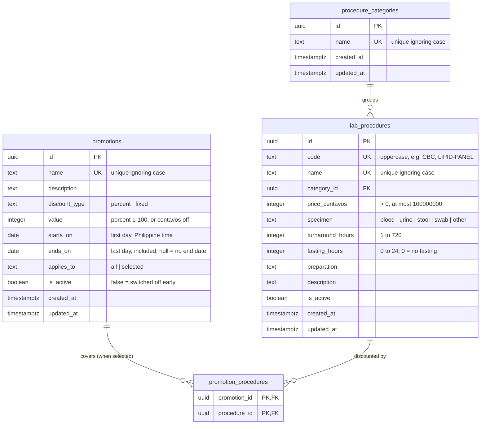

# ERD: Catalog (Lab Procedures)

Tables added by Module 3. Prices are integer centavos (`35000` = ₱350.00).

**Notes**

- Procedures are deactivated, never deleted, so appointments and payments keep pointing at them.
- A category can't be deleted while any procedure (active or not) is in it (`ON DELETE RESTRICT`).
- `turbo run db:seed` adds 6 categories and 21 procedures once, by code; admins' later price changes are kept on re-seed.
- A promotion is **running** when it's switched on and today (Philippine time) is between its first and last day. With no last day (`ends_on` null, e.g. a standing senior/PWD discount) it runs from its first day until switched off. Its status (scheduled, running, ended, off) is worked out from that, not stored.
- `promotion_procedures` has rows only when `applies_to = 'selected'`.
- When several running promotions cover a procedure, the one giving the **lowest price** wins; prices never go below ₱0. Promotions don't stack.
- The seed adds _Senior & PWD Discount_ (20% off everything, from the day the seed runs, no end date) and _Diabetes Check_ (₱200 off FBS and HbA1c, a month later), once, by name.
