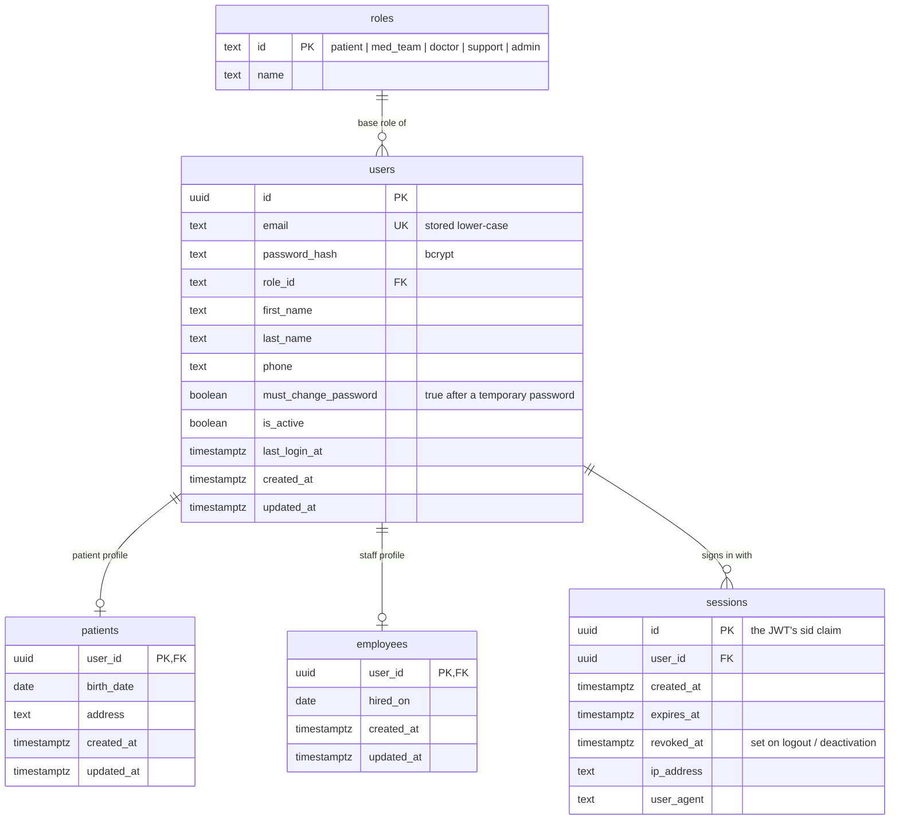

# ERD: Identity & Accounts

Tables added by Module 1 (Authentication & Accounts). Custom roles and permissions are added in Module 2.

**Notes**

- Every access token names its session. A request is only accepted while that session is neither expired nor revoked and the user is active, so logout and deactivation take effect immediately.
- Names and phone live on `users` because every role has them. `patients` and `employees` hold only role-specific fields.
