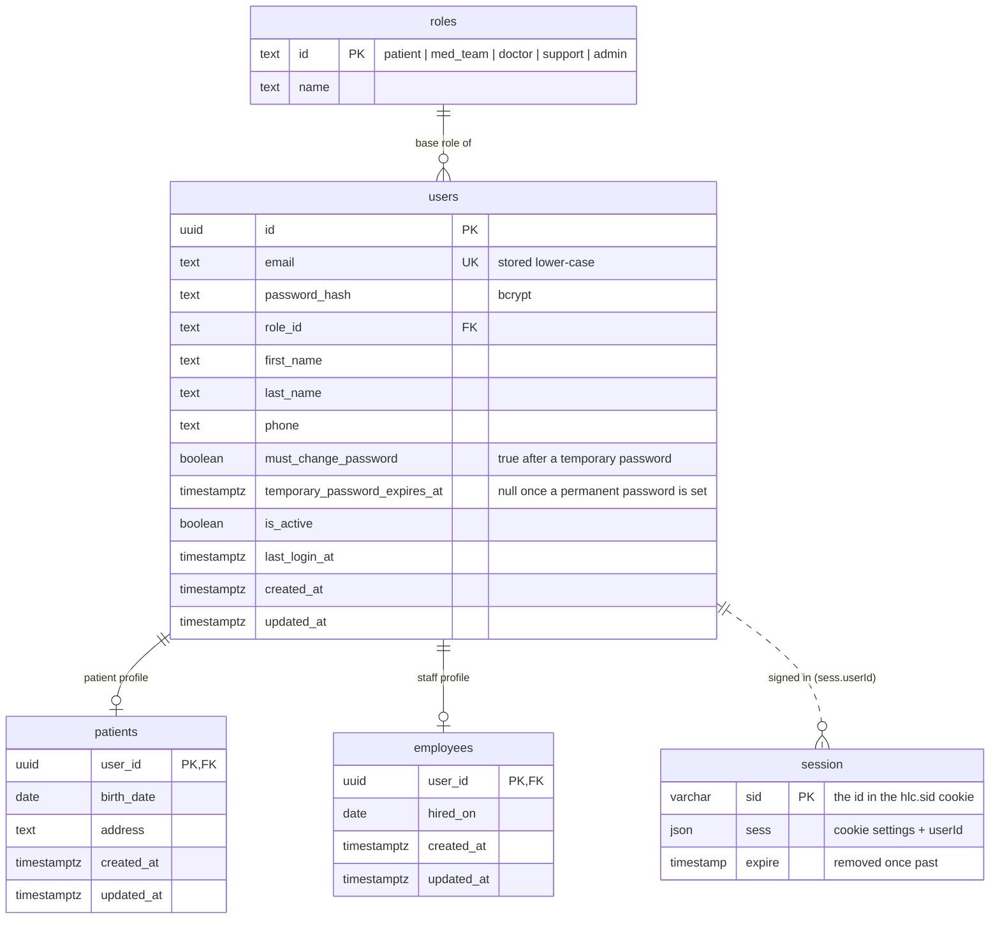

# ERD: Identity & Accounts

Tables added by Module 1 (Authentication & Accounts). Custom roles and permissions are added in Module 2.

**Notes**

- Signing in starts an express-session: the browser gets an httpOnly `hlc.sid` cookie (SameSite=Lax, HTTPS-only in production) and the `session` row (connect-pg-simple's table) records the user. Every request loads the user again, so a deactivated user is refused at once. Logging out, deactivating a user and reissuing a temporary password delete the user's `session` rows.
- Every role (patient, med team, doctor, support, admin) edits their own profile: first name, last name and phone. Patients also edit `patients.birth_date` and `patients.address`, and must keep a phone; for staff the phone is optional. Email and role can't be changed from the profile.
- Changing a password clears `must_change_password` and `temporary_password_expires_at`, and revokes every other session of that user. The session that made the change stays signed in.
- Admins create staff accounts (med team, doctor, support, admin). This adds a `users` row with `must_change_password = true` and an `employees` row, and emails the user a random temporary password. Patients only come from self-registration.
- A temporary password works for **7 days** (`temporary_password_expires_at`). After that, signing in with it fails with `temporary_password_expired`, and the user asks an admin for a new one. It is also rejected by the password change, so a pending session can't finish with it.
- An admin can issue a new temporary password to any active user. It is emailed, works for another 7 days, and revokes every session of that user.
- If the email can't be sent, the account change is kept and the API returns the temporary password to the admin once, so they can hand it over in person.
- Deactivating an account (`is_active = false`) revokes all of its sessions at once. Admins can't deactivate themselves. Reactivating lets the user sign in again.
- Names and phone live on `users` because every role has them. `patients` and `employees` hold only role-specific fields.
