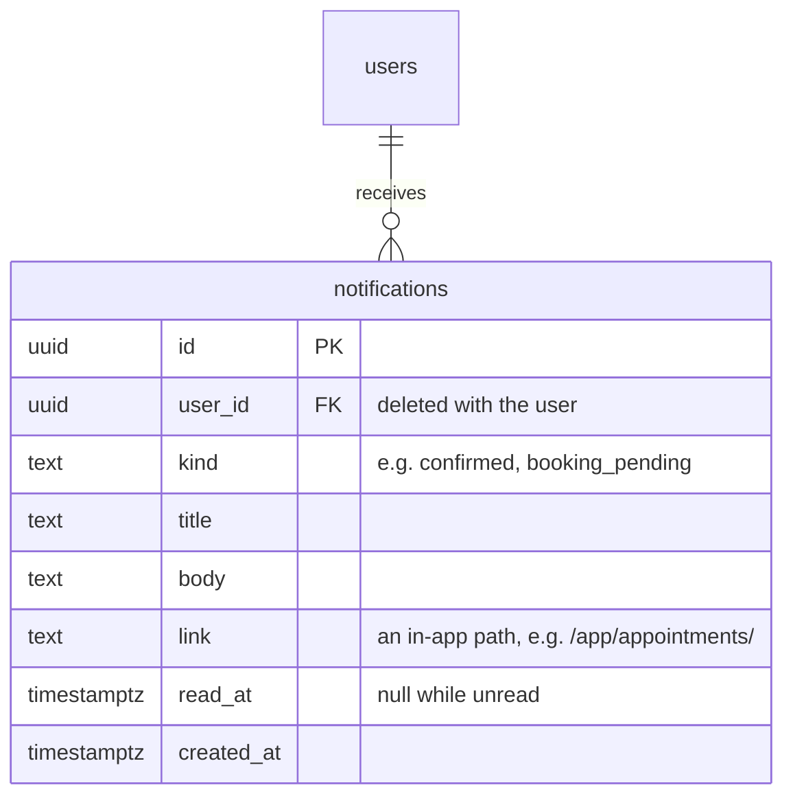

# ERD: Notifications

Table added by Module 9 (Notifications). Each row is one line in one person's bell.

**Who hears what**

| Kind                                                                                                                                 | When                                                                 | Who                            |
| ------------------------------------------------------------------------------------------------------------------------------------ | -------------------------------------------------------------------- | ------------------------------ |
| received, confirmed, rejected, new_time_proposed, cancelled, payment_received, payment_refunded, results_ready, results_ready_unpaid | Whenever the patient is emailed about their visit                    | The patient                    |
| booking_pending                                                                                                                      | A booking waits for staff approval                                   | Support agents and admins      |
| visit_assigned                                                                                                                       | A team is given a visit (by hand, automatically, or a return visit)  | Everyone on that team's roster |
| visit_changed                                                                                                                        | The patient accepts a new time for a visit their team already had    | That team                      |
| visit_cancelled                                                                                                                      | A visit the team had is cancelled, or the new time is declined       | That team                      |
| results_to_review                                                                                                                    | The med team records a visit as collected                            | Doctors                        |
| leave_to_decide                                                                                                                      | Leave is filed, or approved by the team lead                         | The team lead, then the admins |
| leave_decided                                                                                                                        | Leave is approved or rejected                                        | The person who asked           |
| refund_needed                                                                                                                        | A paid visit is cancelled or rejected, or a card payment lands twice | Admins                         |

- Whoever made the change isn't notified about it.
- Saving a notification never fails the change that caused it: like an email, it's a courtesy.
- Each new row is pushed over `GET /api/events` as `notification.new`, so the bell updates at once.
