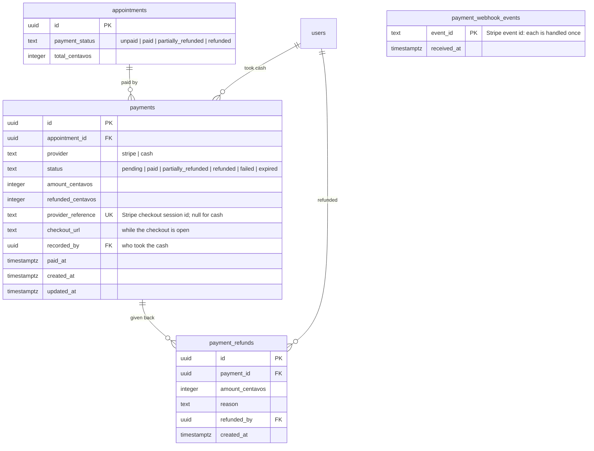

# ERD: Payments

Tables added by Module 7. Money is integer centavos (₱850.00 = 85000), the unit Stripe uses.

**Rules**

- A patient pays by card once the visit is confirmed (also while a new time is proposed, the team is on the way, or after collection). The med team takes cash once they are on the way, for the whole total.
- Paying (card or cash) sets `appointments.payment_status` to `paid` and adds a "Paid" event, in the same transaction. A ₱0 visit (a return visit) is `paid` from the start.
- A refund is above ₱0 and at most what is left. Card refunds go through Stripe; cash refunds are only recorded. The payment and the appointment become `partially_refunded`, then `refunded`.
- Refunds are never automatic. A paid visit that is cancelled or rejected is flagged **Needs refund** until an admin refunds it.
- Stripe may send a webhook more than once: `payment_webhook_events` makes a repeat do nothing.
