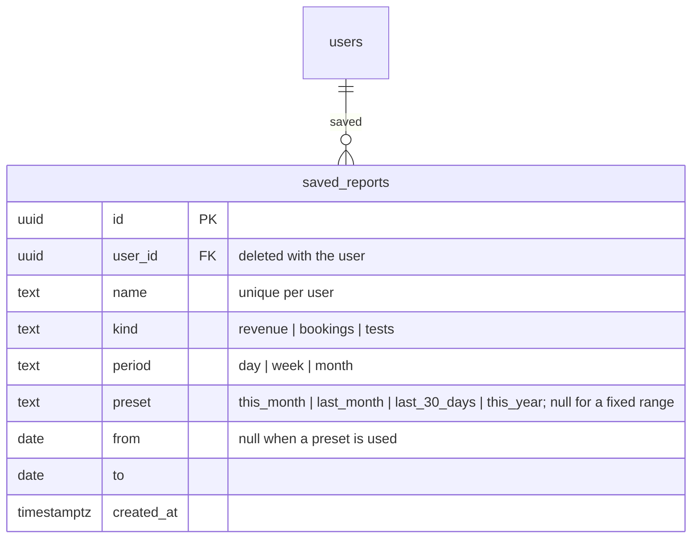

# ERD: Saved reports

Table added by Module 11 (Reports). The reports themselves are read straight from appointments, payments and tests; only the shortcuts people save are stored.

**How the reports count**

- **Revenue:** payments by the day they were paid (Philippine time): card, cash, refunded, and kept (= taken − refunded). Discounts come from each booked test's promotion, on visits booked in the range that weren't cancelled or rejected.
- **Bookings & visits:** bookings by the day they were made, and what became of them (confirmed, rejected, cancelled, collected, not collected, return visits). Collection rate = collected ÷ (collected + not collected). The top reasons come from the rejection or cancellation note.
- **Tests:** every test on visits booked in the range: how often it was ordered and collected, and its revenue (price − discount, on visits that weren't cancelled or rejected).
- Weeks start on Monday. Quiet days, weeks or months still get a row of zeros. A range is at most 366 days.
- A saved preset ("This month") is worked out again each time it's opened.
