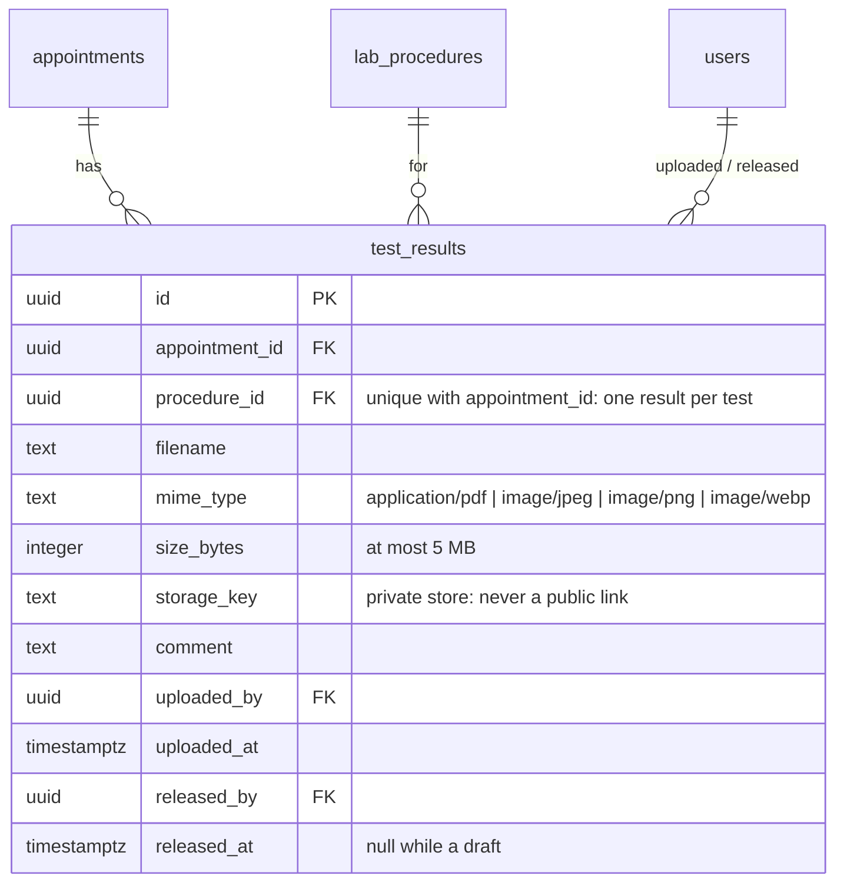

# ERD: Results

Tables added by Module 6. Each collected test of a visit gets one result: a private file (PDF or photo) and an optional comment.

**Rules**

- Results go on the **collected** tests of a **collected** visit. A new upload replaces the draft (the old file is deleted).
- **Release** needs a result for every collected test, happens once, adds a "Results released" event and emails the patient. Released results can't be replaced or removed.
- The patient sees results once they're released **and** the visit is paid (a ₱0 return visit counts as paid). Before that: "pending" (with the doctor) or "locked" (ready, pay to view).
- Files are opened through `GET /api/results/:id/file`, which checks access first: doctors (`results.review`) any time, the patient once ready. In production it redirects to a Cloudinary link that expires after 5 minutes; locally it sends the file.
- `payments.duplicate`: a card payment that completed after the visit was already paid (e.g. cash). It's flagged **Needs refund**.
