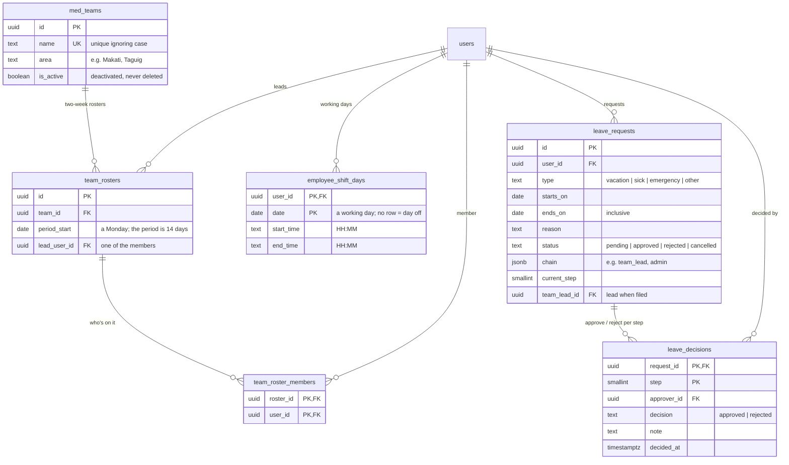

# ERD: Scheduling & Teams

Tables added by Module 4. Dates are whole days and times are "HH:MM", in Philippine time.

**Rules**

- **Rosters** run in fixed two-week periods (Monday to the Sunday after next), counted from Monday 2026-01-05. A person is on at most one team per period, and the lead is one of the members. "Copy previous two weeks" fills an empty period.
- **Shifts are set month by month:** an admin picks the hours once (e.g. 8:00 AM–5:00 PM), picks days on the calendar (or a quick pick: Mon–Fri, Mon–Sat, every day; quick picks skip holidays) and applies them, or makes the picked days off. A date with no shift is a day off.
- **A person's day** is decided in this order: approved leave (shown even on a day they were scheduled) → a scheduled shift (someone can be put to work on a holiday on purpose) → a closed day from Holidays & Closed Days → off.
- **Leave approval chain** (fixed when filed; it replaces the `leave_approval_rules` table in SYSTEM.md):
  - a med team member on a team: **team lead**, then **admin**;
  - team leads, med team on no team, doctors and support: **admin** only.
- **Who decides a step:** the team lead step is the requester's lead, or anyone with `leave.approve` who isn't an admin (e.g. Senior Med Tech); the admin step is an admin with `leave.approve`. Nobody decides their own request. A rejection ends the request.
- Leave can't overlap the requester's other pending or approved leave, is at most 30 days, and can't start in the past (sick and emergency: up to 7 days back). The requester can cancel pending leave, or approved leave that hasn't started.
- `turbo run db:seed` adds Team Makati (lead Juan, with Paolo) for this period and the next, an empty Team Quezon City, and the next 60 days of shifts for staff who have none: med team Mon–Sat 6:00–14:00, doctors Mon–Fri 8:00–17:00, support Mon–Sat 8:00–17:00.
