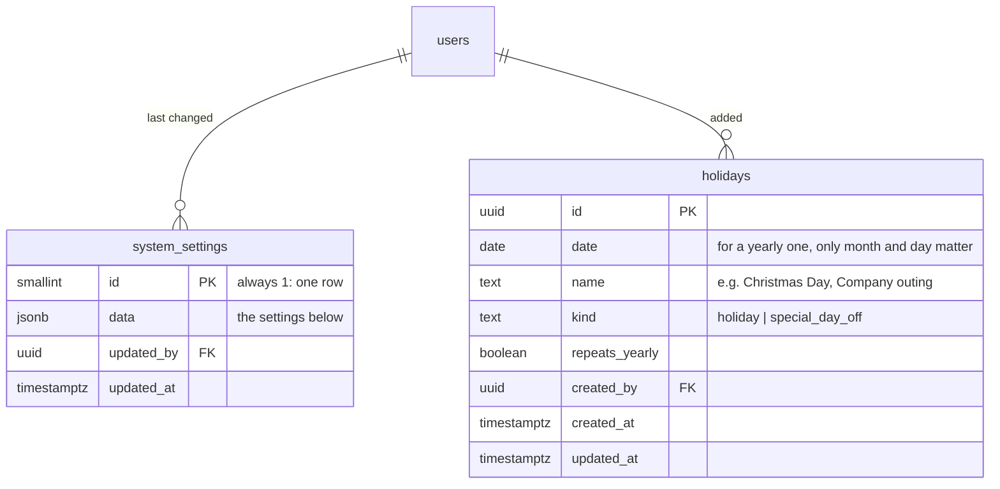

# ERD: Settings and closed days

Tables added by Module 12 (part 1). Dates and times are Philippine time.

**What's in `system_settings.data`** (defaults in brackets)

| Key                      | Meaning                                                            |
| ------------------------ | ------------------------------------------------------------------ |
| `visitDays`              | Weekdays visits happen, 0 = Sunday … 6 = Saturday [every day]      |
| `visitStart`, `visitEnd` | Visit hours, half-hour steps ["06:00"–"12:00"]                     |
| `slotMinutes`            | Time slot length: 30, 60 or 90 [60]                                |
| `minNoticeHours`         | How long before a visit it must be booked [24]                     |
| `bookingWindowDays`      | How far ahead patients can book [30]                               |
| `cancelCutoffHours`      | Patients can cancel up to this long before [24]                    |
| `visitsPerTeamPerDay`    | Daily capacity per med team [8]                                    |
| `bookingApproval`        | `staff` (someone accepts each booking) or `automatic` [staff]      |
| `teamAssignment`         | `manual` or `auto` (team on shift with the fewest visits) [manual] |

**Notes**

- With no row, the defaults apply. A saved row is merged over the defaults when read, so a setting added later needs no data migration.
- A **closed day** blocks booking on its date. A yearly one blocks that month and day every year, so it clashes with any other entry on the same month and day (409 `closed_day_exists`).
- A date is bookable when its weekday is a visit day, it isn't closed, and it's between the minimum notice and the end of the booking window (`isBookableDate` in `domain/settings/closedDay.ts`).
- `turbo run db:seed` adds the fixed-date Philippine regular holidays as yearly closed days, once (New Year's Day, Labor Day, Independence Day, Bonifacio Day, Christmas Day, Rizal Day). Moving holidays like Holy Week are added per year by an admin.
