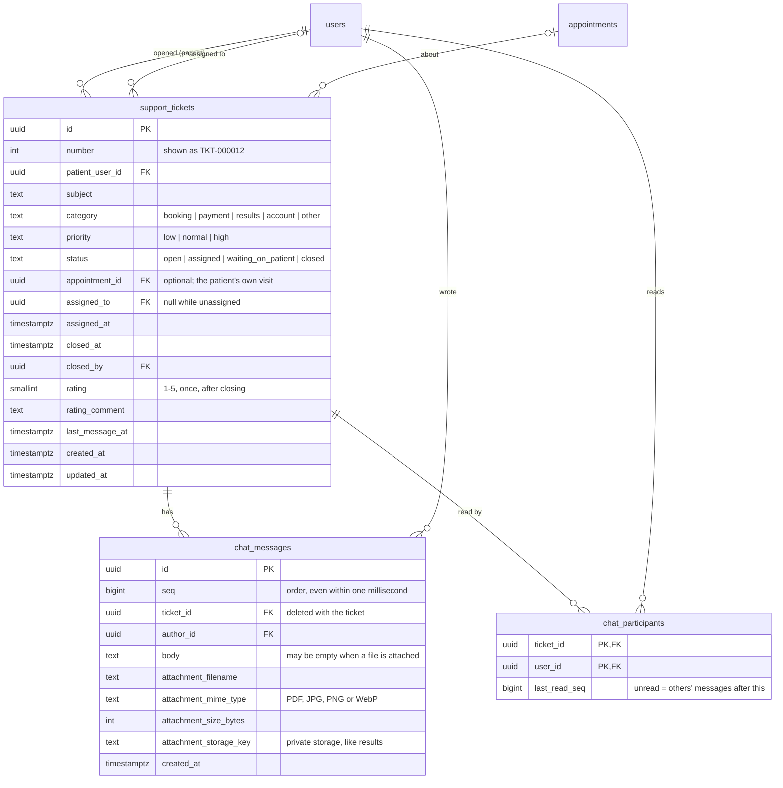

# ERD: Support desk

Tables added by Module 8 (Support Desk). A patient opens a ticket; it's chatted about in `chat_messages`, and `chat_participants` remembers how far each person has read.

**How tickets move**

- **Auto-assign:** a new ticket goes to the active support agent on shift right now (an `employee_shift_days` row for today in Philippine time covering this minute, and no approved leave) with the fewest open tickets; on a tie, whoever got a ticket longest ago. With nobody on shift it stays `open` (unassigned) until an agent claims it or replies.
- **Statuses:** an agent's reply sets `waiting_on_patient`; the patient's reply sets `assigned` (or `open` without an agent). The patient, or support with `support.close`, closes it.
- **Reopening:** a patient's reply within 7 days of closing reopens the ticket; after that they open a new one. Agents can't write in a closed ticket.
- **Rating:** the patient rates once, after it's closed.
- **Live updates:** each change is pushed over `GET /api/events` (Server-Sent Events) to the patient and every active support agent and admin; the browser refetches what it shows.
